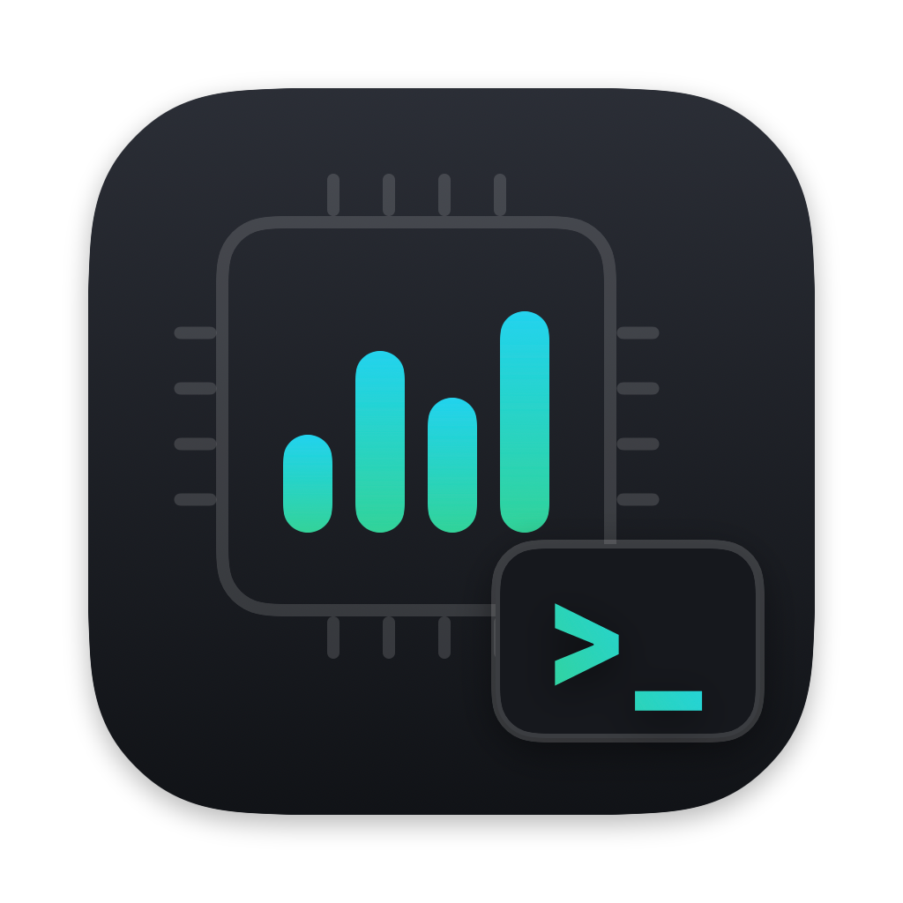
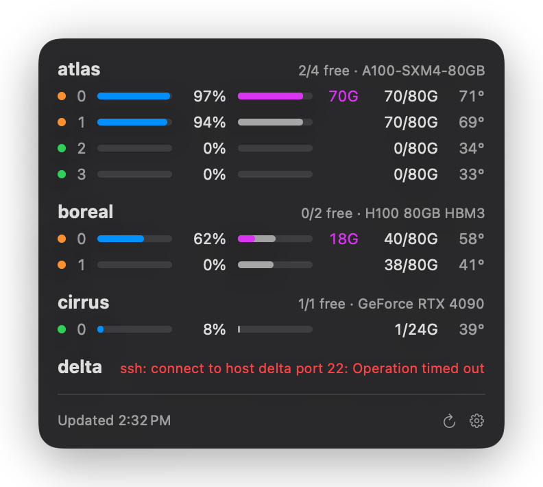

<p align="center"></p>

<h1 align="center">GPUBar</h1>

<p align="center">NVIDIA GPU usage on your SSH machines, in the macOS menu bar.</p>

The menu bar shows free GPUs and mean utilization across all hosts, e.g. `6/12 · 23%`.
Click it for utilization, memory and temperature per GPU.
Memory held by your own processes shows in purple.

<p align="center"></p>

## Requirements

- macOS 14 or later
- Xcode or the Command Line Tools (`xcode-select --install`)
- Key-based SSH access to each host, with `nvidia-smi` installed there

## Build and launch

```sh
git clone https://github.com/sdraeger/gpubar
cd gpubar
./build.sh
open GPUBar.app
```

## Configure

List one SSH host per line in `~/.config/gpubar/hosts`:

```sh
mkdir -p ~/.config/gpubar
printf '%s\n' gpu-node-1 gpu-node-2 > ~/.config/gpubar/hosts
```

Hosts resolve through `~/.ssh/config`, so users, jump hosts and `ControlMaster` work as in your terminal.
The file is re-read on every refresh.

The gear menu sets the refresh interval and launch at login.
A GPU counts as free when its utilization is under 10% and it uses less than 5% of its memory.
